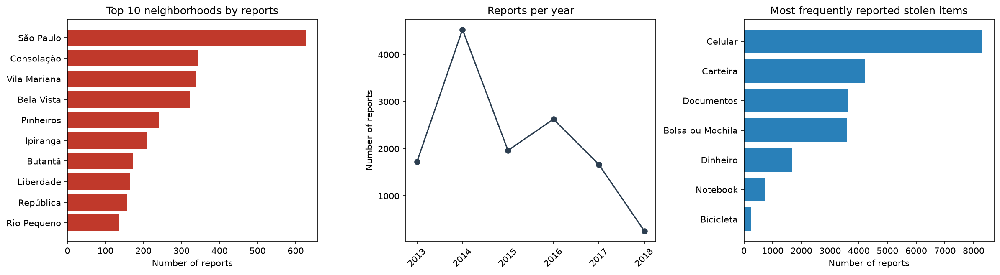
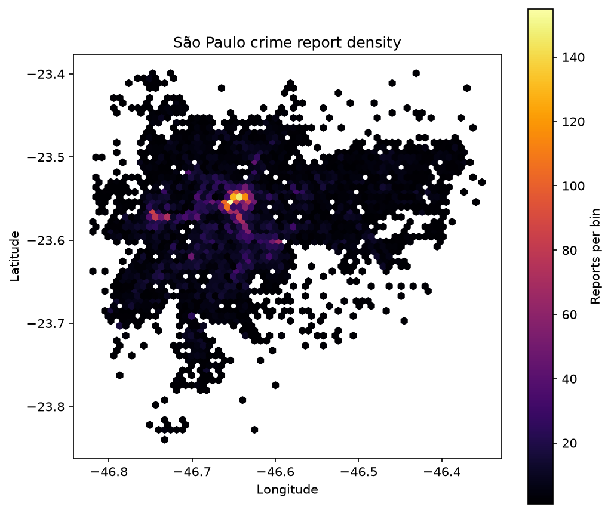
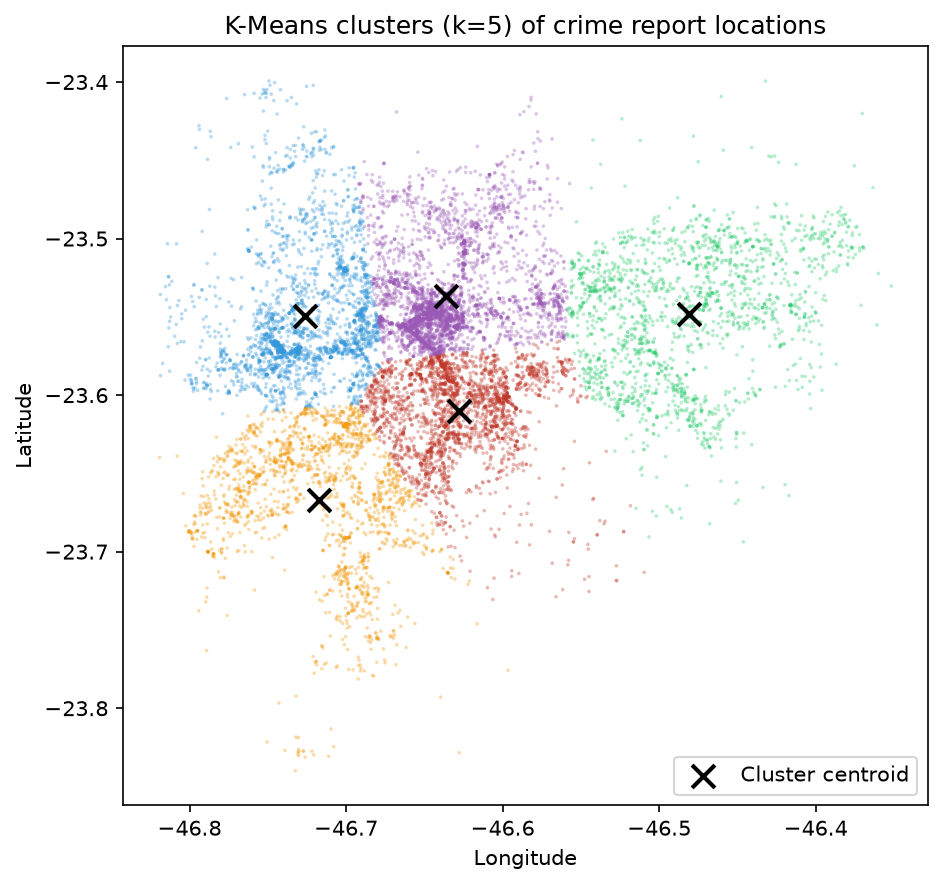

# Geospatial Analysis: São Paulo Crime Database

A geospatial exploration of about 13,000 crowd-sourced crime reports in São Paulo, Brazil: hotspot heatmaps, neighborhood-level statistics, K-Means clustering of report locations and an animated view of how reports changed over time.

**Notebook:** [`Geospatial_Analysis.ipynb`](Geospatial_SaoPaulo_CrimeAnalysis/Geospatial_Analysis.ipynb)  
**Dataset:** [Geospatial São Paulo Crime Database](https://www.kaggle.com/datasets/danlessa/geospatial-sao-paulo-crime-database) (Kaggle), user-submitted theft and robbery reports with coordinates, timestamps and stolen items  
**Stack:** `pandas` · `folium` (Leaflet.js) · `scikit-learn` · `matplotlib`

---

## Overview

| | |
|---|---|
|  | Reports concentrate in a handful of central neighborhoods, peak in 2014 and are lower afterwards, and skew toward opportunistic theft (phones, wallets, bags) rather than planned burglary. |

## Hotspot density



The notebook also builds an **interactive** Leaflet heatmap ([`heatmap_hotspots.html`](Geospatial_SaoPaulo_CrimeAnalysis/maps/heatmap_hotspots.html)) and a version overlaid with official subprefecture boundaries ([`heatmap_by_subprefecture.html`](Geospatial_SaoPaulo_CrimeAnalysis/maps/heatmap_by_subprefecture.html)).

## K-Means clustering

K-Means (k=5, chosen with the elbow method) divides the reports into five spatial regions:



An interactive version with per-cluster popups is in [`kmeans_clusters.html`](Geospatial_SaoPaulo_CrimeAnalysis/maps/kmeans_clusters.html). K-Means always returns k groups, so the regions summarise where reports lie rather than test for hotspots. A density-based method such as DBSCAN would be the next step.

## Crime reports over time

[`heatmap_timelapse.html`](Geospatial_SaoPaulo_CrimeAnalysis/maps/heatmap_timelapse.html) is an animated heatmap (via `folium.plugins.HeatMapWithTime`) showing how report density shifted month by month from July 2013 to March 2018.

---

## Repository structure

```
Geospatial_SaoPaulo_CrimeAnalysis/
├── Geospatial_Analysis.ipynb      # main notebook (Part 1: own analysis, Part 2: course exercises)
├── requirements.txt
├── data/
│   ├── README.md                  # data source and description
│   ├── dataset-limpo.csv          # not included, download it from Kaggle (see data/README.md)
│   └── subprefeituras-sp.geojson  # subprefecture boundaries of São Paulo
├── images/                        # static charts, also embedded in this README
└── maps/                          # standalone interactive HTML maps exported by the notebook
```

## Running it yourself

```bash
cd Geospatial_SaoPaulo_CrimeAnalysis
pip install -r requirements.txt
```

1. Download `dataset-limpo.csv` from the [Kaggle dataset](https://www.kaggle.com/datasets/danlessa/geospatial-sao-paulo-crime-database) (free Kaggle account needed) and place it in `data/`. The subprefecture boundaries are already included (details in [`data/README.md`](Geospatial_SaoPaulo_CrimeAnalysis/data/README.md)).
2. Open `Geospatial_Analysis.ipynb` and run Part 1 top to bottom.

> **Note on interactive maps:** GitHub's notebook preview renders folium/Leaflet output in a sandboxed `iframe`. If a map looks blank in your viewer, open the notebook via [nbviewer](https://nbviewer.org/), run it locally in Jupyter or open the corresponding file in `maps/` directly in a browser.

## About Part 2

The notebook's second half contains my worked exercises from Kaggle's free [*Geospatial Analysis*](https://www.kaggle.com/learn/geospatial-analysis) micro-course (GeoPandas, coordinate reference systems, choropleths, geocoding). It is kept as a reference for techniques explored while building Part 1. It is not original analysis and is not executed by default, since it depends on a separate course dataset bundle (see [`data/README.md`](Geospatial_SaoPaulo_CrimeAnalysis/data/README.md)).

## Key findings

- **Spatial concentration:** reports cluster in a few dense central areas rather than spreading evenly across the city.
- **Temporal pattern:** the reports run from July 2013 to March 2018 and peak in 2014 (about 4,500), which likely reflects the reporting platform's popularity as much as real trends.
- **Item profile:** phones, wallets and bags dominate reported losses, pointing to opportunistic street theft as the predominant pattern in this dataset.
- **Caveat:** this is a crowd-sourced, self-reported dataset. It reflects reporting behavior as much as underlying crime incidence and is not an official police record.

---

*Originally built in spring 2025; repository cleaned up and restructured in autumn 2026.*
